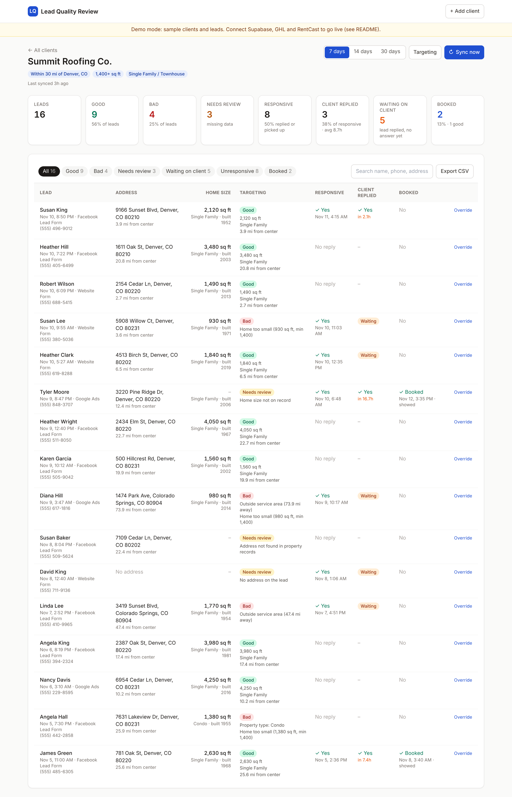

# Lead Quality Review

Internal dashboard. Every morning it pulls the last 7 days of leads for each active client from GoHighLevel, looks up each home, and checks it against that client's targeting. It also shows who replied, whether the client replied back, and who booked.




## What it checks

| Column | Where it comes from |
|---|---|
| **Home size, property type, year built** | RentCast property records, looked up by the lead's address (each address is looked up once and cached) |
| **Targeting: Good / Bad / Needs review** | **Bad**: outside the service area, too small or too large, or a property type the client doesn't accept. **Needs review**: no address, or the address isn't in property records. **Good**: everything checks out. The team can override any grade and leave a note. |
| **Responsive** | The lead texted, emailed or messaged in, called in, or picked up a call that lasted 30 seconds or more (GHL Conversations) |
| **Client replied** | After the lead engaged, someone on the client's team sent a message or had a connected call. Workflow and campaign messages don't count. Shows how long the reply took. |
| **Waiting on client** | The lead replied but the client hasn't. This is the follow-up list. |
| **Booked** | Any GHL appointment for the contact that isn't cancelled |

Service area = listed ZIP codes **or** within X miles of a center address (either one is enough).

## Going live

1. **Supabase**: create a project, run `supabase/schema.sql` in the SQL editor.
2. **RentCast** (rentcast.io): API key for home size lookups. Pricing is per lookup, and each address is only looked up once.
3. **Google Maps** (optional): Geocoding API key. It places addresses that aren't in RentCast on the map and turns a client's center address into coordinates. You can reuse the Google Cloud project from the quoting tool.
4. **Deploy to Vercel** with these environment variables:

```
SUPABASE_URL=
SUPABASE_SERVICE_ROLE_KEY=
RENTCAST_API_KEY=
GOOGLE_MAPS_API_KEY=        # optional
DASHBOARD_PASSWORD=         # team login
CRON_SECRET=                # any long random string; Vercel Cron sends it automatically
```

5. **For each client**: click "Add client". In their GHL sub-account go to Settings → Private Integrations → Create a token with read access to Contacts, Conversations, Conversation Messages and Calendar Events. Paste the token and the location ID, click **Test connection**, then set the targeting.

The daily sync runs at 11:00 UTC (`vercel.json`). "Sync now" runs it on demand. Without Supabase keys the app runs in demo mode with sample data.

## Dev

```
npm install
npm run dev
npm test
```
