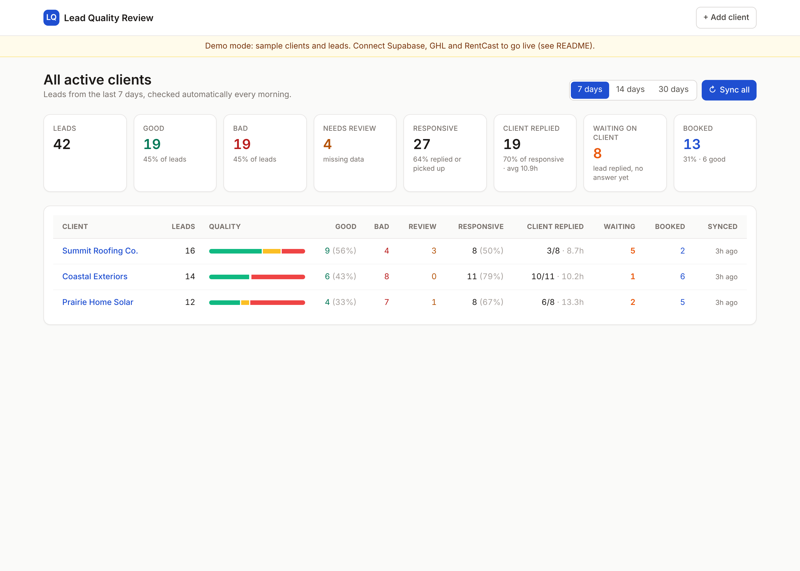

# Lead Quality Review

Internal dashboard. Every Monday at 7:00 AM (Philippine time) it pulls the last 7 days of leads for each active client from GoHighLevel, measures the roof (roofing clients) or the home (home improvement clients), and checks it against that client's targeting. It also shows who replied, whether the client replied back, and who booked.




## What it checks

| Column | Where it comes from |
|---|---|
| **Roof size** (roofing and "both" clients) | Google Solar API: total roof area across all roof sections, plus average pitch |
| **Home size, property type, year built** (home improvement and "both" clients) | Scraped from the Redfin listing page, with Zillow as a fallback. Both block cloud servers, so this goes through ScraperAPI. |

Each address is looked up once per company type and cached.
| **Targeting: Good / Bad / Needs review** | **Bad**: outside the service area, roof/home too small or too large, or (home improvement) a property type the client doesn't accept. **Needs review**: no address, or no roof/home data found. **Good**: everything checks out. The team can override any grade and leave a note. |
| **Responsive** | The lead texted, emailed or messaged in, called in, or picked up a call that lasted 30 seconds or more (GHL Conversations) |
| **Client replied** | After the lead engaged, someone on the client's team sent a message or had a connected call. Workflow and campaign messages don't count. Shows how long the reply took. |
| **Waiting on client** | The lead replied but the client hasn't. This is the follow-up list. |
| **Booked** | Any non-cancelled appointment for the contact on any of the sub-account's calendars (read in one sweep per sync). If GHL refuses the calendar read, the error shows on the client's page instead of the lead looking unbooked. |

Service area = listed ZIP codes **or** inside any of the client's pins (each pin is a city, address or `lat, lng` with its own radius, like Facebook location targeting).

Incomplete addresses: the roof/home is only measured when Google finds the exact house. A lead with only a street, city or ZIP is still checked against the service area (Bad if outside), and otherwise graded per the client's setting: Needs review (default) or Bad.

## Going live

1. **Supabase**: create a project, run `supabase/schema.sql` in the SQL editor. On an existing database, also run each file in `supabase/migrations/` in order.
2. **Google Cloud** (can be the same project as the quoting tool): one API key with **Geocoding API** and **Solar API** enabled.
3. **ScraperAPI** (scraperapi.com): API key for the Redfin/Zillow scrape. Only needed if you have home improvement clients.
4. **Deploy to Vercel** with these environment variables:

```
SUPABASE_URL=
SUPABASE_SERVICE_ROLE_KEY=
GOOGLE_MAPS_API_KEY=        # Geocoding + Solar
SCRAPER_API_KEY=            # home improvement clients
DASHBOARD_PASSWORD=         # team login
CRON_SECRET=                # any long random string; Vercel Cron sends it automatically
```

5. **For each client**: click "Add client". In their GHL sub-account go to Settings → Private Integrations → Create a token with read access to Contacts, Conversations, Conversation Messages, Calendars and Calendar Events. Paste the token and the location ID, click **Test connection**, then set the targeting.

The weekly run is set in `vercel.json` as `0 23 * * 0`: Sunday 23:00 UTC, which is Monday 7:00 AM in the Philippines. "Sync now" on a client page pulls the last 30 days for that client, and a new client's first sync does the same, so the 14- and 30-day views are filled in. The weekly run pulls the last 7 days. Without Supabase keys the app runs in demo mode with sample data.

## Dev

```
npm install
npm run dev
npm test
```
